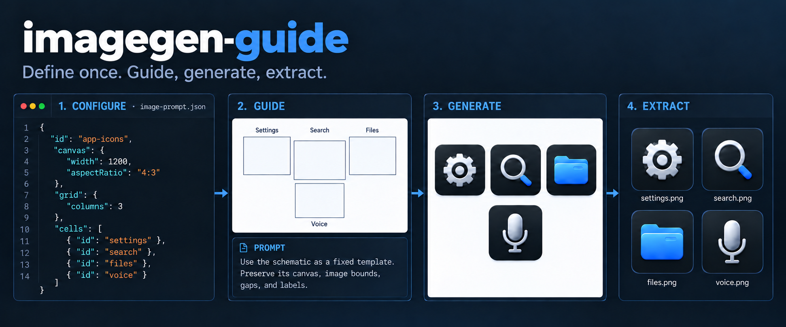
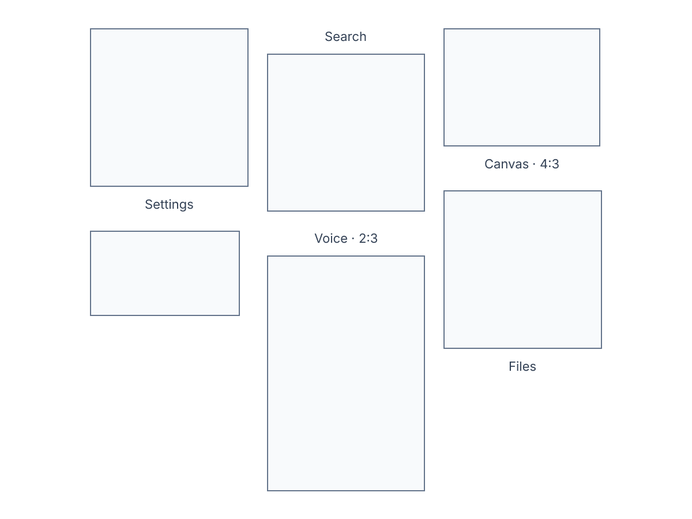
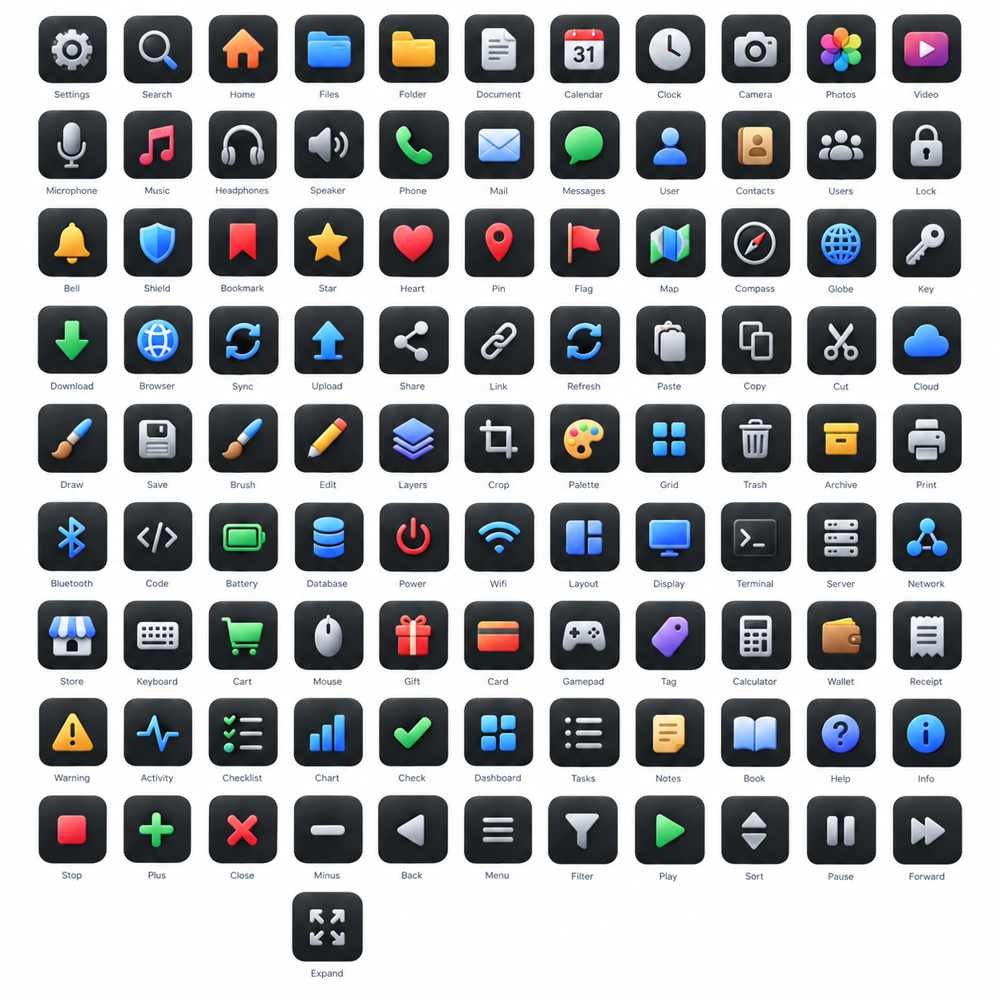

<div align="center">

# imagegen-guide

**One configuration. A guide for generation and individual images from its output.**

Headless image layout for generation workflows.

</div>



This guide comes from [mixed.json](packages/imagegen-guide/examples/configs/mixed.json). Each outlined image region has a stable ID and a crop rectangle. Labels sit outside leaf crops.

## From layout to images

```ts
import { readFile, writeFile } from "node:fs/promises";
import { createAtlas, cropImages } from "imagegen-guide";

const atlas = await createAtlas({
  config: {
    id: "app-icons",
    canvas: { width: 1200, aspectRatio: "4:3", padding: 48 },
    grid: { columns: 2, gap: 24 },
    appearance: { label: { fontFamily: "Roboto", fontWeight: 700 } },
    cells: [
      { id: "settings", label: { text: "Settings" } },
      { id: "search", label: { text: "Search" } },
      { id: "files", label: { text: "Files" } },
      { id: "voice", label: { text: "Voice" } },
    ],
  },
});

// Give atlas.schematic and atlas.prompt to your image generator.
// Inspect the result: each image must fit its guide rectangle.
const [settings] = await cropImages({
  atlas,
  source: await readFile("generated.png"),
  ids: ["settings"],
});
await writeFile("settings.png", settings.bytes);
```

`cropImages` uses the guide rectangles by default and scales them to the source dimensions. It preserves source alpha; it does not remove backgrounds or fix artwork outside a rectangle.

## See the output

The [generated 100-icon atlas](docs/assets/generated-icons.png) is a separate visual example of this workflow. A model can drift from the guide; planned rectangles do not certify that generated pixels match them.



Run the example, generate `atlas.png` from its guide and prompt, then crop it from the saved layout:

```sh
vp run cli -- --example mixed --out examples/output
# Send examples/output/mixed-light.guide.png and examples/output/mixed-light.prompt.txt to the generator.
vp run cli -- crop --layout examples/output/mixed-light.layout.json --source atlas.png --out examples/output/crops
```

The crop command saves `examples/output/crops/app-icons/settings.png` and the other leaf images. Use `--ids settings,search` to select images. `--config path/to/config.json` defines your own atlas. Omit it from the crop command to use planned bounds.

## Layout controls

```json
{
  "id": "variants",
  "canvas": { "width": 1200, "aspectRatio": "4:3", "padding": 48 },
  "grid": { "columns": 2, "gap": 24 },
  "appearance": { "preset": "dark" },
  "defaults": { "aspectRatio": "1:1" },
  "cells": [
    {
      "id": "settings",
      "children": {
        "grid": { "columns": 2, "gap": 8 },
        "cells": [
          { "id": "settings-light", "prompt": "Light variant." },
          { "id": "settings-dark", "prompt": "Dark variant." }
        ]
      }
    }
  ]
}
```

See the runnable [variant configuration](packages/imagegen-guide/examples/configs/variants.json) for a full atlas. Groups retain their hierarchy in the catalogue and can be cropped by ID. Cells also support mixed ratios, explicit dimensions, weighted columns, spans, scoped descriptions, labels, and appearance overrides.

To locate observed bounds, set `"crop": { "detect": {} }` in the configuration and pass it to `generate --source` or `crop --config`. Detection requires one separate foreground region per leaf image on a uniform background. Connected tiles, shadows across gaps, and missing tiles make detection fail. Use the crop command above for planned bounds. `compareCatalogues` reports differences; neither path certifies image quality.

## Package and development

```ts
import { createAtlas, cropImages, createCatalogue, detectCatalogue } from "imagegen-guide";
```

Importing the package for guide creation does not load Sharp. Image operations load it when called and can extract PNG, JPEG, WebP, or AVIF. `createCatalogue` exposes source-specific IDs and rectangles when a consumer needs JSON metadata or saved output references.

```sh
pnpm install
pnpm run check
pnpm run build
```

Node.js 22.18 or later is required. [Requirements](docs/requirements.md), [specification](docs/specification.md), [build order](docs/implementation-plan.md), and [dependency research](docs/research.md) define the product contracts. Licensed under [MIT](LICENSE).
