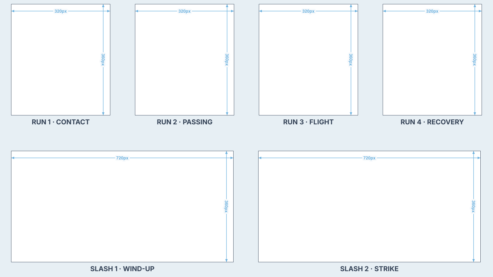

<div align="center">

# imagegen-guide

**One configuration. A guide for generation and individual images from its output.**

Headless image layout for generation workflows.

</div>


This guide comes from [mixed.json](packages/imagegen-guide/examples/configs/mixed.json). Each outlined image region has a stable ID and a crop rectangle. Labels sit outside leaf crops.

## From layout to images

```ts
import { readFile } from "node:fs/promises";
import { createAtlas, cropImages } from "imagegen-guide";

const atlas = await createAtlas({
  config: {
    id: "app-icons",
    canvas: { width: 1200, aspectRatio: "4:3", padding: 48 },
    grid: { columns: 2, gap: 24 },
    appearance: { label: { fontFamily: "Roboto", fontWeight: 700 } },
    cells: [
      { id: "settings", label: { text: "Settings" } },
      { id: "search", label: { text: "Search" } },
      { id: "files", label: { text: "Files" } },
      { id: "voice", label: { text: "Voice" } },
    ],
  },
});

// Give atlas.schematic and atlas.prompt to your image generator.
// Inspect the result: each image must fit its guide rectangle.
const [settings] = await cropImages({
  atlas,
  source: await readFile("generated.png"),
  ids: ["settings"],
});
// settings.bytes is the PNG; settings.crop is its source rectangle.
```

`atlas.imageIds` lists the configured IDs. With a TypeScript config literal, editors use those IDs for `cropImages.ids` and GIF frame IDs. `cropImages` uses the guide rectangles by default and scales them to the source dimensions. It preserves source alpha; it does not remove backgrounds or fix artwork outside a rectangle.

## See the output

The [generated 100-icon atlas](docs/assets/generated-icons.png) is a separate visual example of this workflow. A model can drift from the guide; planned rectangles do not certify that generated pixels match them.


Install `imagegen-guide` in a consumer project. Its `imagegen-guide` command makes a guide, crops a generated source, and makes a GIF as separate actions. Generate `atlas.png` from the guide before cropping:

```sh
vp add imagegen-guide
vp exec imagegen-guide guide --example mixed --out atlas-job
# Send atlas-job/mixed-light.guide.png and atlas-job/mixed-light.prompt.txt to the generator.
vp exec imagegen-guide crop --layout atlas-job/mixed-light.layout.json --source atlas.png --out atlas-job/crops
```

The guide command saves no artwork. The crop command saves `atlas-job/crops/app-icons/settings.png` and the other leaf images. Its result shows the source dimensions and crop count. Use `--ids settings,search` to select images. Use `--config path/to/config.json` for your own guide. Omit it from the crop command to use planned bounds. In this repository, `vp run cli --` calls the same command source.

## Layout controls

```json
{
  "id": "variants",
  "canvas": { "width": 1200, "aspectRatio": "4:3", "padding": 48 },
  "grid": { "columns": 2, "gap": 24 },
  "appearance": { "preset": "dark" },
  "defaults": { "aspectRatio": "1:1" },
  "cells": [
    {
      "id": "settings",
      "children": {
        "grid": { "columns": 2, "gap": 8 },
        "cells": [
          { "id": "settings-light", "prompt": "Light variant." },
          { "id": "settings-dark", "prompt": "Dark variant." }
        ]
      }
    }
  ]
}
```

See the runnable [variant configuration](packages/imagegen-guide/examples/configs/variants.json) for a full atlas. Groups retain their hierarchy in the catalogue and can be cropped by ID. Cells also support mixed ratios, explicit dimensions, weighted columns, spans, scoped descriptions, labels, and appearance overrides. Set `image.backgroundImage` on a cell to show a reference image in its guide region; `backgroundSize` and `backgroundPosition` control its placement, and it does not repeat by default.

To locate observed artwork bounds, set `"crop": { "detect": {} }` in the configuration and pass it to `crop --config`. Detection searches each planned tile and its share of the surrounding gaps. It accepts transparent tiles on an opaque outer background. Set `crop.detect.background` when the first source pixel does not represent that outer background. Set `alphaThreshold` to change which partly transparent pixels count as artwork. Artwork that crosses into another tile's search area can still be cut; detection does not repair the image. Use the crop command above for planned bounds. `compareCatalogues` reports differences; neither path certifies image quality.

## Measured guides



The [animation guide configuration](packages/imagegen-guide/examples/configs/adventurer-animations.json) enables `appearance.image.dimensionLines`. The schematic shows each resolved width and height in canvas pixels. Dimension lines do not change crop bounds. When a generated source uses another resolution, crop bounds scale to that source.

The same configuration requests filled space outside the image rectangles and transparent backgrounds within them:

```json
"output": { "background": "#e7eff4", "transparentCrops": true }
```

`cropImages` preserves the alpha in the generated source. It does not remove an opaque background or correct artwork that crosses a crop boundary.

## Animate named frames

```ts
import { readFile, writeFile } from "node:fs/promises";
import { createAtlas, createGif } from "imagegen-guide";

const atlas = await createAtlas({
  config: {
    id: "run-cycle",
    canvas: { width: 1600, aspectRatio: "16:9" },
    grid: { columns: 4, gap: 80 },
    cells: [
      { id: "contact" },
      { id: "passing" },
      { id: "flight" },
      { id: "recovery" },
    ],
  },
});

// Generate run-sheet.png from atlas.schematic and atlas.prompt first.
const source = await readFile("run-sheet.png");
const gif = await createGif({ atlas, source });
await writeFile("run.gif", gif);

// Select a different order and override one frame's default delay.
const selected = await createGif({
  atlas,
  source,
  delay: 100,
  frames: ["contact", "passing", { id: "flight", delay: 180 }, "recovery"],
});
await writeFile("selected.gif", selected);
```

Without `frames`, the GIF uses all leaf images in layout order, a 100 ms delay, and an infinite loop. `frames` sets order and may repeat an ID. A group ID expands to its leaf images in layout order; a delay on that group applies to each child frame. The output centers frames of different sizes on a transparent canvas.

The CLI uses the same defaults:

```sh
vp exec imagegen-guide guide --example adventurer-animations --out atlas-job
# Generate run-sheet.png from the returned guide and prompt.
vp exec imagegen-guide gif --layout atlas-job/adventurer-animations-light.layout.json --source run-sheet.png --out atlas-job
```

## Package and development

```ts
import { createAtlas, cropImages, createGif, createCatalogue, detectCatalogue } from "imagegen-guide";
```

Importing the package for guide creation does not load Sharp. Image operations load it when called and can extract PNG, JPEG, WebP, or AVIF. `createCatalogue` exposes source-specific IDs and rectangles when a consumer needs JSON metadata or saved output references.

```sh
pnpm run setup:install
pnpm run check
pnpm run build
```

Node.js 22.18 or later is required. [Requirements](docs/requirements.md), [specification](docs/specification.md), [build order](docs/implementation-plan.md), and [dependency research](docs/research.md) define the product contracts. Licensed under [MIT](LICENSE).
