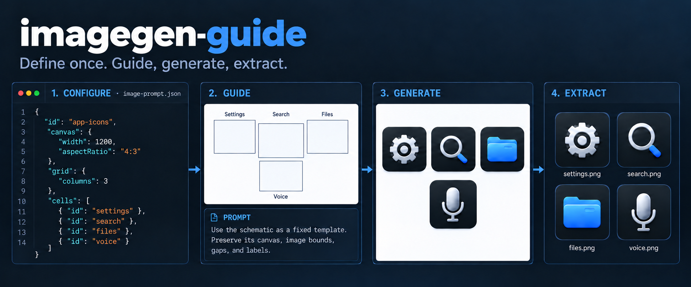
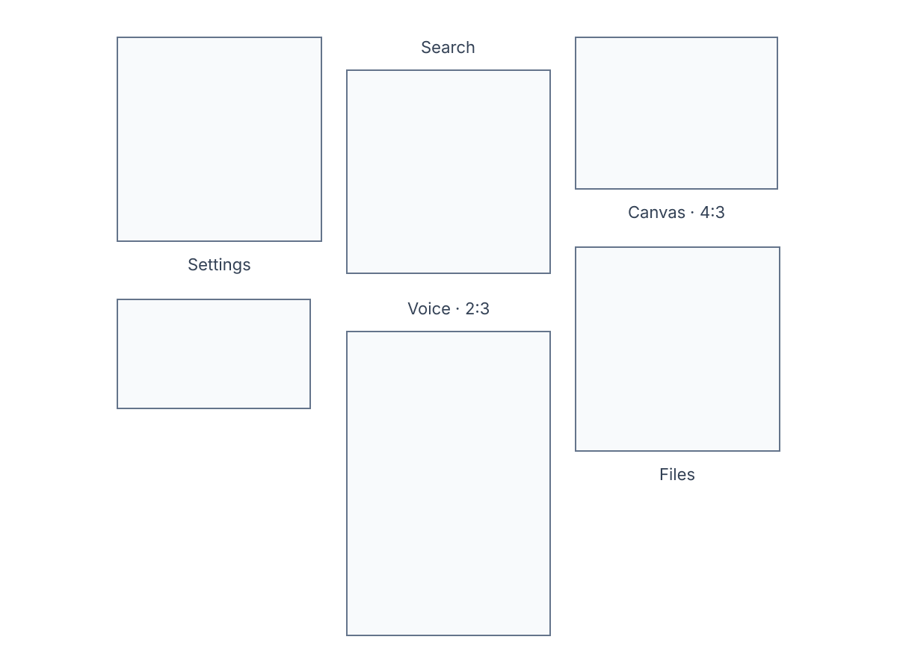
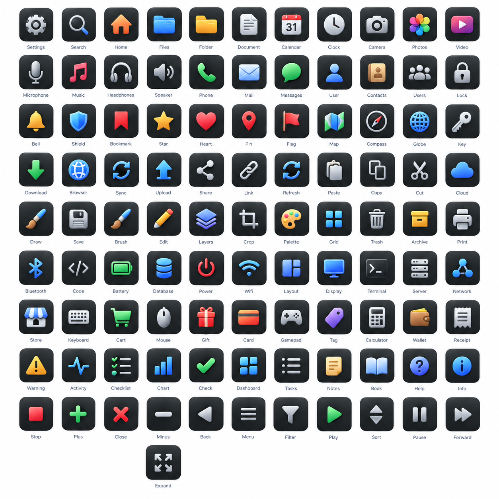

<div align="center">

# imagegen-guide

**One atlas definition. A precise guide, prompt, catalogue, and crops.**

Headless image layout for generation workflows.

</div>



This guide comes from [mixed.json](packages/imagegen-guide/examples/configs/mixed.json). Each outlined image region has a stable ID and a crop rectangle. Labels sit outside leaf crops.

## From layout to images

```ts
import { readFile, writeFile } from "node:fs/promises";
import { schema, createAtlas, createCatalogue } from "imagegen-guide/core";
import { cropImages } from "imagegen-guide/core/image";

const config = schema.Config.assert({
  id: "icons",
  canvas: { width: 1200, aspectRatio: "3:2", padding: 48 },
  grid: { columns: 2, gap: 32 },
  appearance: { label: { fontFamily: "Inter" } },
  cells: [
    { id: "settings", label: { text: "Settings" } },
    { id: "search", aspectRatio: "4:3", label: { text: "Search", position: "above" } },
  ],
});

// Supply a TTF, OTF, or WOFF font. The core does not download fonts.
const font = await readFile("Inter-Regular.woff");
const atlas = await createAtlas({
  config,
  fonts: [{ name: "Inter", data: font, weight: 400, style: "normal" }],
});

await writeFile("guide.svg", atlas.schematic);
console.log(atlas.prompt); // Provider-independent instructions and per-image context.

// Supply the generated image and its actual pixel dimensions.
const source = await readFile("generated.png");
const catalogue = createCatalogue({
  layout: atlas.layout,
  source: { id: "generation-01", uri: "generated.png", width: 1200, height: 800 },
});
await writeFile("catalogue.json", JSON.stringify(catalogue, null, 2));

const [settings] = await cropImages({ source, catalogue, ids: ["settings"] });
await writeFile("settings.png", settings.bytes);
```

`atlas.layout` owns the geometry. The schematic, prompt, and catalogue use that same layout. The catalogue maps its rectangles to the source resolution. The caller owns generation, file storage, and any UI.

## See the output

The [generated 100-icon atlas](docs/assets/generated-icons.png) is a separate visual example of this workflow. A model can drift from the guide; planned rectangles do not certify that generated pixels match them.



Run the example program to save a guide, prompt, layout JSON, and catalogue:

```sh
pnpm run cli -- --example mixed
pnpm run cli -- --example variants
pnpm run cli -- --example icons --source atlas.png
```

Outputs go to `examples/output/`. The `--source` form reads the generated image's dimensions and saves leaf crops. Use `--ids settings,search` to select IDs or `--config path/to/config.json` for your own atlas.

## Layout controls

```json
{
  "id": "variants",
  "canvas": { "width": 1200, "aspectRatio": "4:3", "padding": 48 },
  "grid": { "columns": 2, "gap": 24 },
  "appearance": { "preset": "dark" },
  "defaults": { "aspectRatio": "1:1" },
  "cells": [
    {
      "id": "settings",
      "children": {
        "grid": { "columns": 2, "gap": 8 },
        "cells": [
          { "id": "settings-light", "prompt": "Light variant." },
          { "id": "settings-dark", "prompt": "Dark variant." }
        ]
      }
    }
  ]
}
```

See the runnable [variant configuration](packages/imagegen-guide/examples/configs/variants.json) for a full atlas. Groups retain their hierarchy in the catalogue and can be cropped by ID. Cells also support mixed ratios, explicit dimensions, weighted columns, spans, scoped descriptions, labels, and appearance overrides.

For separated foreground tiles on a uniform background, `detectCatalogue` from `imagegen-guide/core/image` can locate observed leaf bounds. `compareCatalogues` reports signed differences from planned bounds. Detection does not correct merged tiles or certify image quality.

## Package and development

```ts
import { schema, createAtlas, createCatalogue, compareCatalogues } from "imagegen-guide/core";
import { cropImages, detectCatalogue } from "imagegen-guide/core/image"; // Node image processing
```

The layout entry point is independent of Sharp, UI frameworks, and generation providers. `core/image` uses Sharp for PNG, JPEG, WebP, and AVIF extraction.

```sh
pnpm install
pnpm run check
pnpm run build
```

Node.js 22.18 or later is required. [Requirements](docs/requirements.md), [specification](docs/specification.md), [build order](docs/implementation-plan.md), and [dependency research](docs/research.md) define the product contracts. Licensed under [MIT](LICENSE).
